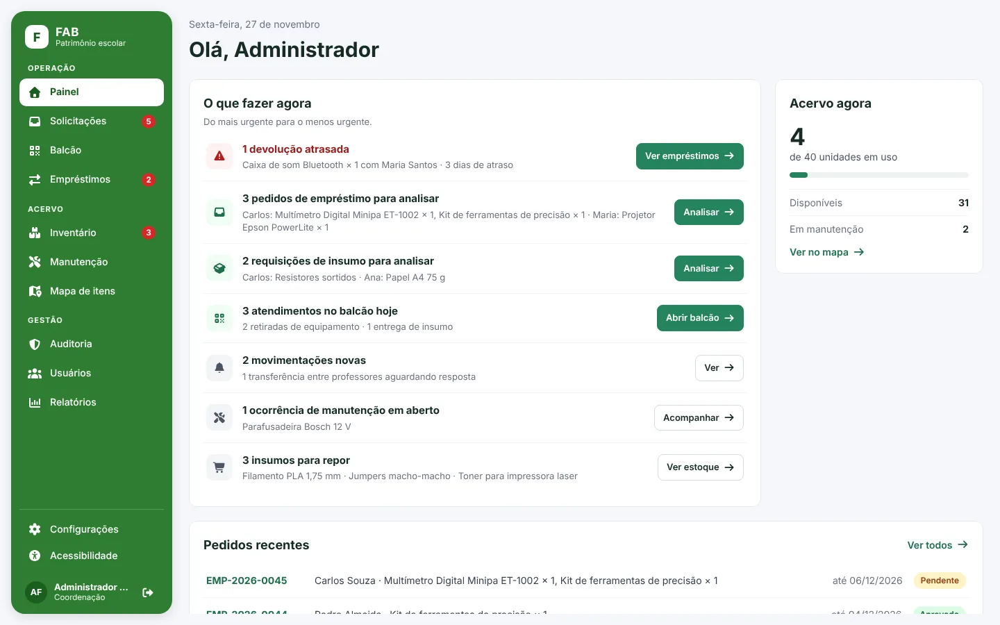
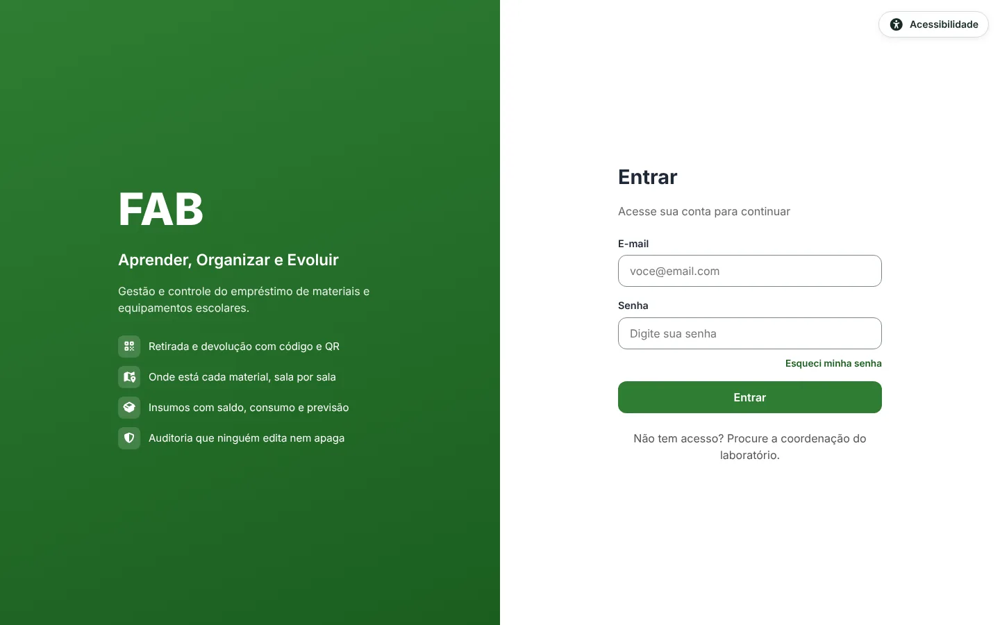
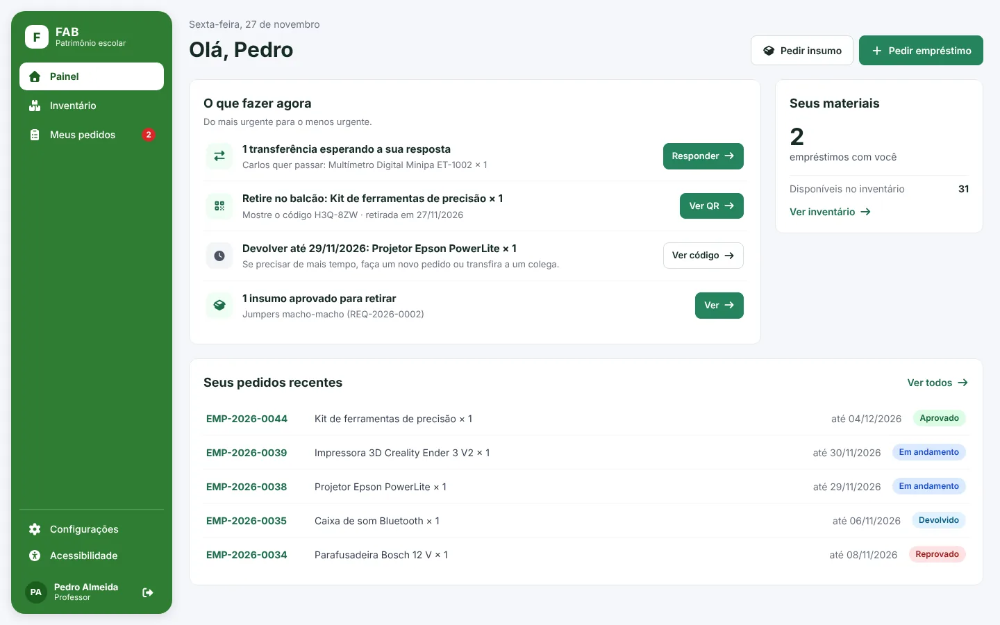
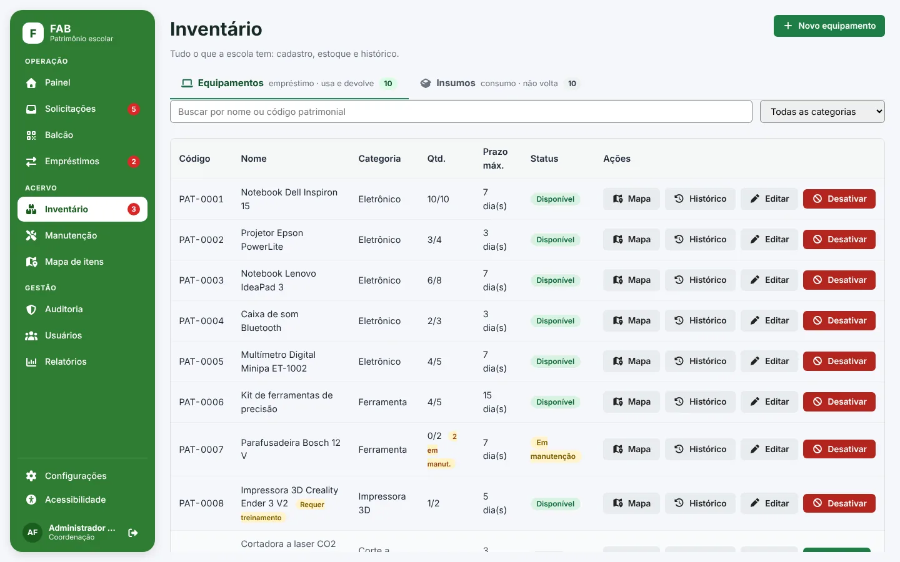
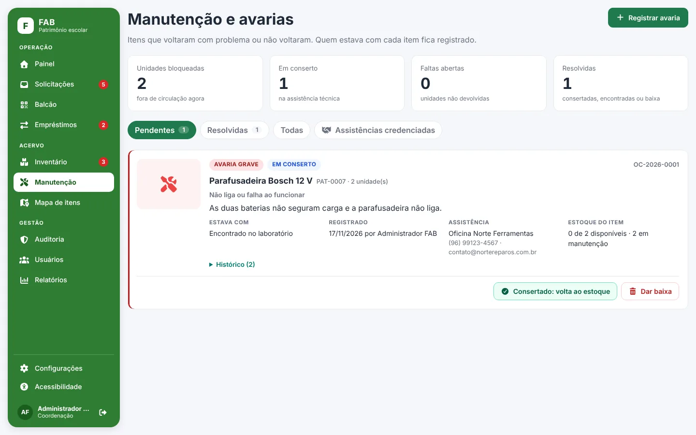
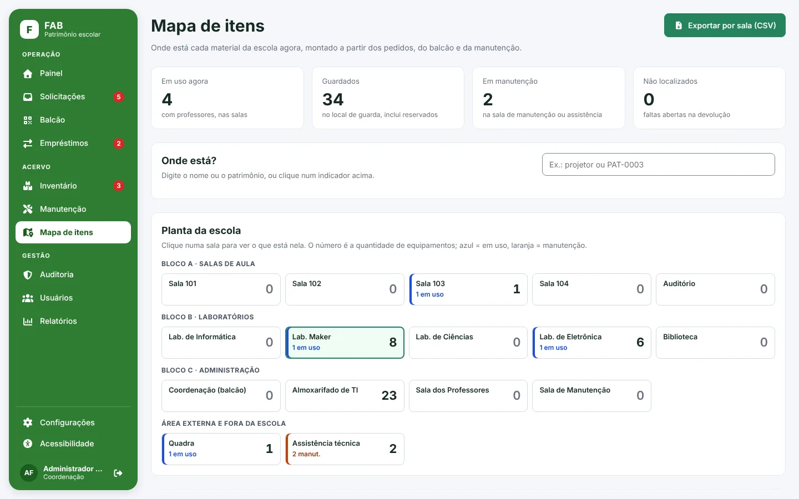

<div align="center">

# FAB · Aprender, Organizar e Evoluir

**Controle do patrimônio escolar: empréstimo de equipamentos, insumos, manutenção e auditoria, num só lugar.**

[](https://github.com/liamelliotz/fab/actions/workflows/verificar.yml)


Projeto Integrador · Programador Full Stack · **SENAI Macapá (AP)**<br>
Feito para a **Escola Estadual Mayra do Carmo** pela equipe **Team Rocket Projects**



</div>

---

## Sumário

- [O problema](#o-problema)
- [O que o FAB faz](#o-que-o-fab-faz)
- [Telas](#telas)
- [Comece em 1 minuto](#comece-em-1-minuto)
- [Instalação completa](#instalação-completa)
- [Tecnologias](#tecnologias)
- [Estrutura do repositório](#estrutura-do-repositório)
- [Comandos](#comandos)
- [Documentação](#documentação)
- [Como contribuir](#como-contribuir)
- [Problemas comuns](#problemas-comuns)
- [Situação do projeto](#situação-do-projeto)
- [Equipe](#equipe)

---

## O problema

O empréstimo de equipamentos da escola era feito em planilha ou de boca. Não se sabia quem estava com cada
item, quando ele voltaria nem em que estado. Os materiais de consumo acabavam sem aviso, e as avarias
e perdas não deixavam registro.

## O que o FAB faz

| | |
| :--- | :--- |
| 📋 **Painel "O que fazer agora"** | Cada perfil abre o sistema e vê as pendências do dia, da mais urgente para a menos urgente, com o botão que leva direto à ação. |
| 📦 **Inventário único** | Equipamentos (usa e devolve) e insumos (consumo) na mesma aba, com estoque, valor de cada item e histórico. |
| 🔁 **Ciclo do empréstimo** | O professor pede e a coordenação aprova, reservando o estoque. Na retirada, o balcão confere o código ou o QR. A devolução registra avarias e faltas, e o material pode passar a um colega com aceite. |
| ⚖️ **Regras configuráveis** | Pedido aprovado e não retirado **expira** e libera a reserva. **Limite por categoria** por pessoa. **Política de atraso**: só avisar, bloquear ou **suspender automaticamente** (dias de atraso × fator). Tudo ajustável pela coordenação e registrado na auditoria. |
| 🧪 **Insumos** | Entradas e saídas com responsável, saldo que nunca fica negativo, alerta de estoque baixo e previsão de quando acaba. Itens perecíveis têm validade obrigatória. O professor pede pela requisição, com a quantidade prevista; retira no **balcão com código e QR** e devolve a sobra (ou diz que usou tudo) do mesmo jeito. Requisição não retirada expira. |
| 📦 **Balcão sem espera** | **Separar** antes da retirada (roteiro por sala, uma volta só) e **guardar** depois da devolução. Máquinas que não saem da sala são entregues lá, pelo celular. O mapa mostra onde cada item está de verdade. |
| 🛠️ **Manutenção** | O conserto só vai para **assistências técnicas credenciadas** (CNPJ validado, especialidade e prazo). Dá para consertar ou dar baixa em **parte das unidades**, dizendo quais. |
| 🧾 **Baixa patrimonial** | Termo numerado para imprimir. O valor vem do cadastro (ninguém digita), e furto ou roubo exige o número do B.O. |
| 🗺️ **Mapa de itens** | Onde está cada material, sala por sala, com exportação do inventário por sala em CSV. |
| 🛡️ **Auditoria** | Toda ação fica gravada, sem edição nem exclusão, com filtros e exportação. |
| 📊 **Relatórios** | Retiradas e consumo por período, a partir dos registros reais. |
| ♿ **Acessibilidade** | **Modo escuro** (ou automático), fonte de leitura fácil **Atkinson Hyperlegible**, tradutor de Libras **VLibras**, suporte ao leitor de tela **NVDA**, alto contraste, fonte maior, foco reforçado e navegação completa pelo teclado. Fontes e ícones vêm embutidos: funcionam sem internet. |

**Perfis.** O **professor** consulta o inventário, pede empréstimos e insumos e acompanha os próprios pedidos.
A **coordenação** (administrador) aprova pedidos, opera o balcão e cuida do acervo, da manutenção, dos usuários e
dos relatórios. Só a coordenação cria contas: não existe cadastro público.

## Telas

<table>
  <tr>
    <td width="50%"><br><sub><b>Login</b>, com acesso ao painel de acessibilidade</sub></td>
    <td width="50%"><br><sub><b>Painel do professor</b>: o que retirar, devolver e responder</sub></td>
  </tr>
  <tr>
    <td><br><sub><b>Inventário</b>: equipamentos e insumos em abas</sub></td>
    <td><br><sub><b>Manutenção</b>: conserto, assistências credenciadas e baixa</sub></td>
  </tr>
  <tr>
    <td colspan="2" align="center"><br><sub><b>Mapa de itens</b>: onde está cada material agora</sub></td>
  </tr>
</table>

---

## Comece em 1 minuto

Para ver o FAB funcionando **sem banco e sem backend** (os dados ficam no navegador):

```bash
git clone https://github.com/liamelliotz/fab.git
cd fab/frontend
npm ci
npm run demo
```

Abra <http://localhost:4200> e entre com uma das contas:

| Perfil | E-mail | Senha |
| :--- | :--- | :--- |
| Coordenação | `admin@fab.com` | `admin123` |
| Professor | `professor@fab.com` | `prof123` |
| Outros professores (João, Maria, Carlos, Ana) | `joao@escola.br` etc. | `prof123` |

> [!TIP]
> Para voltar aos dados iniciais, use **Ctrl + Alt + Shift + R**.
> Para mostrar os dois lados de um fluxo (professor e coordenação), use duas abas do navegador: cada aba guarda a sua sessão.

## Instalação completa

### 1. O que instalar

| Ferramenta | Versão | Conferir |
| :--- | :--- | :--- |
| Node.js | 24 LTS (traz o npm 11) | `node -v` |
| Git | 2.30 ou mais nova | `git --version` |
| Docker Desktop | atual, só para o banco | `docker -v` |

```powershell
# Windows (PowerShell)
winget install OpenJS.NodeJS.LTS Git.Git Docker.DockerDesktop
```

### 2. Backend (API)

```bash
cd backend
npm ci
cp .env.example .env         # PowerShell: Copy-Item .env.example .env
npm run start:dev
```

A API fica em <http://localhost:3000/api> e o Swagger em <http://localhost:3000/api/docs>.
Por padrão (`PERSISTENCIA=memoria`) os dados ficam em memória e voltam ao início quando a API reinicia.

### 3. Banco de dados (opcional)

```bash
docker compose up -d         # na raiz: sobe o PostgreSQL 16
cd backend
npm run db:reset             # cria as tabelas e grava os dados de exemplo
```

Depois, coloque `PERSISTENCIA=postgres` no `.env`. Para apagar tudo e recomeçar: `docker compose down -v`.

### 4. Frontend ligado à API

Em outro terminal:

```bash
cd frontend
npm ci
npm start                    # login de verdade pela API (deixe o backend rodando)
```

| Serviço | Porta |
| :--- | :--- |
| Frontend | 4200 |
| Backend | 3000 |
| PostgreSQL | 5432 |

---

## Tecnologias

| Camada | Tecnologia |
| :--- | :--- |
| Frontend | Angular 22 (standalone, *signals* e SSR) com CSS próprio, sem biblioteca de componentes |
| Backend | NestJS 12 em ESM, com validação dos dados, Helmet e limite de requisições |
| Banco | PostgreSQL 16 (Docker Compose), migrations em SQL e TypeORM sem `synchronize` |
| Autenticação | JWT e senhas com bcrypt |
| Testes | Vitest, Supertest e verificação de acessibilidade com axe |
| Qualidade | oxlint, Prettier e GitHub Actions em todo Pull Request |
| Acessibilidade | VLibras (Governo Federal), ARIA e anúncios para leitores de tela |

## Estrutura do repositório

```text
fab/
├── frontend/          Aplicação Angular (telas, serviços e modo demonstração)
├── backend/           API NestJS: um módulo por pasta e testes em test/
│   └── database/      migrations em SQL
├── docs/              contrato da API, banco, roteiro da demonstração e imagens
├── docker-compose.yml PostgreSQL 16 para desenvolvimento
└── .github/           verificação automática e modelo de Pull Request
```

`frontend/` e `backend/` são projetos independentes, cada um com o seu `package.json`.

## Comandos

| Onde | Comando | O que faz |
| :--- | :--- | :--- |
| `frontend/` | `npm run demo` | Sobe no modo demonstração, sem backend |
| `frontend/` | `npm start` | Sobe com login real pela API |
| `frontend/` | `npm run lint` · `npm test -- --watch=false` · `npm run build` | Verifica, testa e compila |
| `backend/` | `npm run start:dev` | Sobe a API e reinicia ao salvar |
| `backend/` | `npm run lint` · `npm test` · `npm run test:e2e` | Verifica e testa |
| `backend/` | `npm run db:migrate` · `db:seed` · `db:reset` | Banco de dados |

## Documentação

| Documento | Para quê |
| :--- | :--- |
| [`docs/contrato-api.md`](docs/contrato-api.md) | Contrato único da API: rotas, entradas, saídas, erros e situação de cada rota |
| [`docs/contrato-regras-emprestimo.md`](docs/contrato-regras-emprestimo.md) | Expiração do pedido aprovado, limite por categoria, política de atraso e suspensão |
| [`docs/contrato-requisicao-insumo.md`](docs/contrato-requisicao-insumo.md) | Requisição de insumo com código e QR no balcão, sobra e prazos |
| [`docs/contrato-logistica-balcao.md`](docs/contrato-logistica-balcao.md) | Separar antes da retirada, guardar depois da devolução e itens que ficam na sala |
| [`docs/contrato-patrimonio-assistencias.md`](docs/contrato-patrimonio-assistencias.md) | Valor do patrimônio, perecíveis, assistências credenciadas e baixa parcial |
| [`docs/banco.md`](docs/banco.md) | Diagrama do banco, regras garantidas pelo PostgreSQL e como criar uma migration |
| [`docs/demo-fab.md`](docs/demo-fab.md) | Roteiro da demonstração, passo a passo |
| [`docs/MUDANCAS-v2.md`](docs/MUDANCAS-v2.md) | Histórico da reestruturação do backend (v2) |
| [`frontend/README.md`](frontend/README.md) | Telas, modos de execução e como ligar uma tela à API |
| [`backend/README.md`](backend/README.md) | Variáveis do `.env`, regras do backend e produção |

## Como contribuir

Ninguém trabalha direto na `main`: cada card do Trello vira uma branch e um Pull Request revisado.

```bash
git switch main && git pull
git switch -c feature/d2-movimentacoes      # branch com o código do card
# ... edite só as pastas do seu card ...
npm run lint && npm test                    # na pasta que você mudou
git commit -m "feat(insumos): registra entradas e saídas"
git pull --rebase origin main
git push -u origin feature/d2-movimentacoes # e abra o Pull Request
```

| Prefixo do commit | Uso |
| :--- | :--- |
| `feat(modulo):` | Nova funcionalidade |
| `fix(modulo):` | Correção de erro |
| `docs:` · `test:` · `refactor:` · `chore:` | Documentação, testes, reorganização e configuração |

- Um card por vez, e só nas pastas do seu módulo. Um módulo usa o outro pelo *service* exportado.
- Mudou uma rota? Atualize o `docs/contrato-api.md` no mesmo Pull Request.
- Nunca envie `.env`, senhas, `node_modules/` nem `dist/`.

## Problemas comuns

| Problema | Solução |
| :--- | :--- |
| `npm ci` diz que o `package-lock.json` está fora de sincronia | Você está com o npm 10. Instale o Node 24 (`node -v`). |
| PowerShell: "execução de scripts desabilitada" | Use `npm.cmd` no lugar de `npm`, ou `Set-ExecutionPolicy -Scope CurrentUser RemoteSigned`. |
| Toda rota responde **401** | Faça `POST /auth/login` e envie `Authorization: Bearer <token>`. |
| Login responde **429** | Foram tentativas demais em pouco tempo. Aguarde um minuto. |
| `db:migrate` não conecta | Suba o banco com `docker compose up -d` e confira o `DATABASE_URL` do `.env`. |
| "JWT_SECRET ausente ou fraco" em produção | Gere um: `node -e "console.log(require('crypto').randomBytes(48).toString('hex'))"` |
| Porta 3000, 4200 ou 5432 em uso | Feche o outro processo ou mude a porta (front: `ng serve --port 4300`). |
| O avatar do VLibras não aparece | Ele é carregado de `vlibras.gov.br`. Confira a internet ou se a rede bloqueia o site. |
| Erros estranhos depois de trocar de branch | Apague a pasta `node_modules` e rode `npm ci`. |

## Situação do projeto

| Parte | Situação |
| :--- | :--- |
| Pesquisa, protótipo no Figma e identidade visual | ✅ Pronto |
| Todas as telas do frontend, no modo demonstração | ✅ Pronto |
| Login, recuperação de senha, usuários e configurações pela API | ✅ Pronto |
| Banco de dados modelado e testado no PostgreSQL | ✅ Pronto |
| Rotas de autenticação, usuários, equipamentos (leitura) e empréstimos | ✅ Prontas e testadas |
| Cadastro de insumos na API | ✅ Na `main` |
| Balcão, transferência, manutenção, movimentação de insumos e relatórios na API | 🚧 Em desenvolvimento |
| Todas as telas usando a API (hoje parte delas usa os dados do navegador) | 🚧 Em desenvolvimento |

A situação de cada rota está na coluna "Situação" do [contrato da API](docs/contrato-api.md).

## Equipe

**Team Rocket Projects**

| Integrante | Papel |
| :--- | :--- |
| Liam Elliot Silva da Costa | Gerente de Projeto |
| Arthur Costa | Designer de Experiência |
| Leonardo Picanço Fontinele | Desenvolvedor |
| Alvaro Ronaldy Santos | Desenvolvedor |
| Ana Jolly Garcia da Silva | Documentadora e Pesquisadora |
| Jamilly Barbosa da Costa | Documentadora e Pesquisadora |

**Orientador:** Instrutor Matheus S. Santos

---

<p align="center"><sub>Projeto acadêmico do SENAI · Centro de Formação Profissional de Macapá, Amapá · 2026</sub></p>
