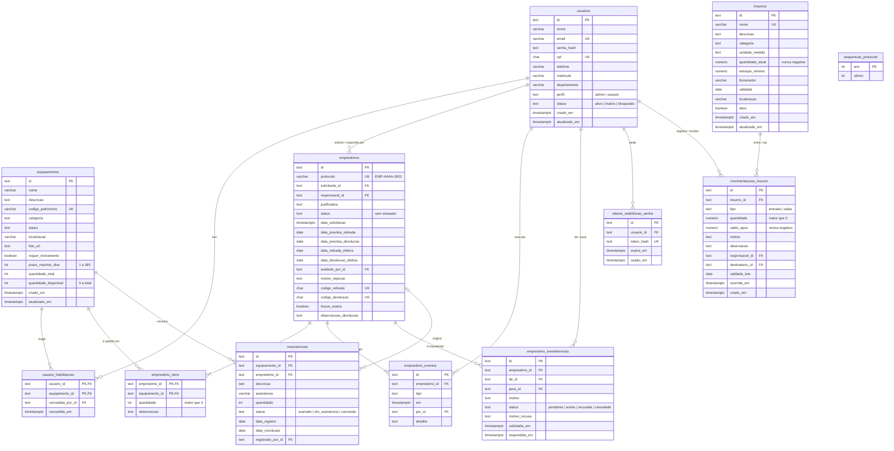

# FAB — Banco de dados (PostgreSQL 16)

O banco é criado por arquivos SQL em `backend/database/migrations/`, aplicados por `npm run db:migrate`.
O arquivo `001_criar_tabelas.sql` é a fonte da verdade: este documento só o explica.

## 1. Como subir

```bash
docker compose up -d            # na raiz do projeto: sobe o PostgreSQL 16 na porta 5432
cd backend
cp .env.example .env            # já traz o DATABASE_URL do docker-compose
npm run db:migrate              # cria as tabelas
npm run db:seed                 # APAGA os dados e grava os de exemplo
```

`npm run db:reset` faz os dois últimos de uma vez. Sem Docker, qualquer PostgreSQL 13 ou mais novo serve
(instalado na máquina ou hospedado): troque o `DATABASE_URL` no `.env`.

## 2. Diagrama ER



## 3. Travas que o próprio banco garante

Estas regras valem mesmo que o backend tenha um bug. Todas foram testadas no PostgreSQL 16.

| Regra | Como o banco garante |
| --- | --- |
| Saldo de insumo nunca negativo | `CHECK (quantidade_atual >= 0)` em `insumos` e `CHECK (saldo_apos >= 0)` nas movimentações |
| Estoque de equipamento entre 0 e o total | `CHECK (quantidade_disponivel BETWEEN 0 AND quantidade_total)` |
| Patrimônio, e-mail, CPF e nome de insumo únicos | índices únicos (patrimônio e nome ignoram maiúsculas e espaços) |
| Protocolo nunca repete | índice único e contador atômico em `sequencias_protocolo` |
| Um código de retirada ou devolução vale para um pedido só | índices únicos parciais |
| Uma transferência pendente por pedido | índice único parcial `WHERE status = 'pendente'` |
| Reprovação exige motivo | `CHECK` em `emprestimos` |
| Linha do tempo e movimentações são só de acréscimo | gatilho `fab_impedir_alteracao` recusa `UPDATE` e `DELETE` |
| Motivo combina com o tipo da movimentação | `CHECK movimentacoes_motivo_do_tipo` |

## 4. Como o backend usa (decisão)

- **ORM: TypeORM 0.3 com `@nestjs/typeorm`**, só como mapeador. `synchronize: false` sempre: quem cria e altera
  tabelas são os arquivos `.sql`. O plano original citava Prisma, mas hoje ele está em transição entre a
  versão 7 e uma 8 ainda em teste, com comandos diferentes; o TypeORM é a integração oficial do NestJS e é estável.
- Cada módulo troca o **seu** repositório em memória por um repositório TypeORM com os **mesmos métodos**
  (`criar`, `buscarPorId`, `listar`, `atualizar`, `remover` e as consultas do módulo). Os services não mudam.
- Operações que mexem em mais de uma tabela (aprovar pedido, devolução, movimentação de insumo) rodam em
  **transação**. Para mudar saldo, use `UPDATE ... SET quantidade = quantidade - $1 WHERE id = $2 AND quantidade >= $1`
  e confira se 1 linha foi alterada: assim dois pedidos simultâneos não levam o mesmo item.
- Os testes unitários continuam com os repositórios em memória (não precisam de banco).

## 5. Mudar o banco depois

Nunca edite um `.sql` que já foi para a `main`. Crie o próximo número (`002_<assunto>.sql`), teste com
`npm run db:reset` e avise no card. Só a **Pessoa A** cria migrations, para dois arquivos nunca terem o mesmo número.
